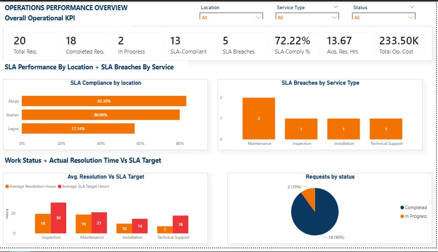

# Operations Performance Analytics

## Project Overview

This project demonstrates how data analytics can support operational decision-making through service performance monitoring, SLA compliance analysis, operating cost analysis, and identification of requests requiring attention.

The project uses a *synthetic service-request dataset* created for portfolio and learning purposes. All records are fictional and do not represent actual company or client data.

The analysis was conducted using SQL and interactive Power BI dashboard to run operational records into measurables performance indicators and actionable insights.

## Power BI Dashboard Preview

## Business Problem

Service organisations need clear visibility into how efficiently requests are handled, whether service-level agreement (SLA) targets are being met, how performance varies across locations, teams and service types, and where operational attention may be required.

Without structured reporting, delays and SLA breaches can be difficult to identify, compare and investigate.

This project demonstrates how SQL analysis and interactive business intelligence reporting can help address these challenges.

## Project Objectives

- Measure service-request volumes and completion status.
- Assess SLA compliance and identify SLA breaches.
- Compare operational performance across locations, teams, and service types.
- Analyse recorded operating costs.
- Identify completed requests that exceeded their SLA targets and requests still in progress.
- Translate analytical findings into practical, evidence-based recommendations.

## Tools and Technologies

- *CSV:* Storage of synthetic service-request records.
- *PostgreSQL / SQL:* Data aggregation, filtering, conditional logic, KPI calculations, and operational performance analysis.
- *Microsoft Power BI:* Interactive dashboard development, data visualisation, and DAX measures.
- *DAX:* Calculation of KPIs, including request volumes, SLA compliance, SLA breaches, average resolution hours, and operating costs.

## Repository Structure

operations-performance-analytics/
- *data*
- *service_requests.csv*
- *sql*
- *perations_analysis.sql*
- README.md

## Methodology

1. *Data preparation:* Inspected the synthetic dataset and reviewed its structure and fields.
2. *Data validation:* Checked the relevant fields and established the definitions used for operational KPIs.
3. *SQL analysis:* Used SQL to aggregate requests, calculate SLA performance, examine breaches, and compare results across operational categories.
4. *Power BI modelling:* Imported the dataset and created DAX measures for KPI reporting.
5. *Dashboard development:* Built an interactive dashboard with KPI cards, charts, and slicers for Location, Service Type, and Status.
6. *Validation:* Compared relevant SQL and Power BI calculations and confirmed that the dashboard's slicers and KPI measures responded to filtering.
7. *Interpretation:* Identified performance patterns and developed recommendations while acknowledging the limitations of the synthetic dataset.

## Project Deliverables

- Synthetic service-request dataset.
- SQL analysis scripts.
- Interactive Power BI performance dashboard.
- KPI measures and operational performance visualisations.
- Summary of findings and evidence-based recommendations.

## Key Performance Indicators

 KPI - Definition

1. Total Requests - Total number of service-request records. 
2. Completed Requests - Requests marked as completed. 
3. In-Progress Requests - Requests not yet completed. 
4. SLA Compliance - Percentage of completed requests resolved within their SLA targets. 
5. SLA Breaches - Number of completed requests resolved beyond their SLA targets. 
6. Average Resolution Hours - Average recorded resolution time for completed requests. 
7. Average Resolution Hours (All Requests) - Average of all nonblank recorded resolution-hour values, including in-progress requests where a value is available. 
8. Total Operating Cost - Sum of the operating-cost values recorded in the synthetic dataset. 

## Key Findings

All findings below are based on the fictional dataset and are intended to demonstrate analytical methods rather than describe actual business performance.

## Overall Operational Performance

- *Total requests:* 20
- *Completed requests:* 18
- *In-progress requests:* 2
- *Average resolution time across all requests:* 13.45 hours
- *Average resolution time for completed requests:* 13.67 hours
- *Total recorded operating cost:* 233,500 synthetic cost units

The two average-resolution figures use different calculation scopes. The 13.45-hour figure includes all records with valid resolution-hour values, while the 13.67-hour figure is restricted to completed requests. Both calculations were checked in Power BI against the corresponding SQL result.

## SLA Compliance

Of the 18 completed requests, 13 were resolved within their SLA targets, while 5 exceeded their targets.

- *SLA compliance:* 72.22%
- *SLA breaches:* 5
- *Total time beyond SLA targets:* 14 hours
- *Average time beyond target per breached request:* 2.8 hours
- *Largest individual delay beyond target:* 5 hours

These findings indicate opportunities to improve SLA performance and investigate the factors contributing to delays.

## Performance by Location

- *Lagos:* 57.14% SLA compliance, with 3 breaches among 7 completed requests.
- *Ibadan:* 80.00% SLA compliance, with 1 breach among 5 completed requests.
- *Abuja:* 83.33% SLA compliance, with 1 breach among 6 completed requests.

Lagos recorded the lowest SLA compliance and accounted for 60% of all recorded breaches. This makes it a priority for further investigation within the synthetic scenario.

## Performance by Team

- *Team A:* 66.67% SLA compliance, with 2 breaches among 6 completed requests.
- *Team B:* 66.67% SLA compliance, with 2 breaches among 6 completed requests.
- *Team C:* 83.33% SLA compliance, with 1 breach among 6 completed requests.

Teams A and B recorded lower compliance than Team C. Further analysis would be needed to determine whether workload, request complexity, resource availability, or other factors explain the difference.

## Performance by Service Type

- *Maintenance:* 40.00% breach rate, with 2 breaches among 5 completed requests.
- *Inspection:* 25.00% breach rate, with 1 breach among 4 completed requests.
- *Technical Support:* 25.00% breach rate, with 1 breach among 4 completed requests.
- *Installation:* 20.00% breach rate, with 1 breach among 5 completed requests.

Maintenance had the highest recorded breach rate in the dataset, making its workflow a useful area for further investigation.

## Recommendations

1. *Investigate location-level performance:* Examine possible workload, scheduling, resource-allocation, and handover issues associated with the lower SLA compliance recorded in Lagos.
2. *Review maintenance processes:* Investigate the requests that exceeded their SLA targets to identify potential sources of delay.
3. *Review team-level differences:* Examine breached requests handled by Teams A and B before deciding whether additional support or process changes are needed.
4. *Monitor operational performance:* Track SLA compliance, resolution time, and breach counts across locations, teams, and service types.
5. *Introduce structured exception tracking:* Record breach causes, corrective actions, responsible owners, and resolution dates.
6. *Use interactive reporting:* Apply the Power BI slicers to investigate performance by location, service type, and request status.

These recommendations are hypotheses for investigation, not proven solutions or claims about actual business operations.

## Limitations

- The dataset contains only 20 fictional service-request records.
- The findings are illustrative and cannot establish actual organisational performance.
- The small sample size limits the reliability and generalisability of comparisons across locations, teams, and service types.
- The analysis identifies patterns and exceptions but does not establish the root causes of SLA breaches.
- Average-resolution calculations depend on the availability and treatment of recorded resolution-hour values.
- Operating costs are synthetic cost units and should not be interpreted as actual currency amounts.

## Important Note

This is an independent portfolio project developed with synthetic data for learning and demonstration purposes. All records, costs, and findings are fictional. No confidential company or client data is included.

## Tools and Skills Demonstrated

- PostgreSQL and SQL querying.
- Data validation and aggregation.
- Conditional logic and filtering.
- KPI definition and calculation.
- SLA compliance and breach analysis.
- DAX measures and Power BI dashboard development.
- Interactive data visualisation and slicer configuration.
- SQL-to-Power BI result validation.
- Operational performance interpretation.
- Evidence-based recommendations and analytical documentation.

## Author

**Kemi Mathew**  
Operations and Data Analytics

[GitHub Profile](https://github.com/oluwakemimathew01-cpu)

